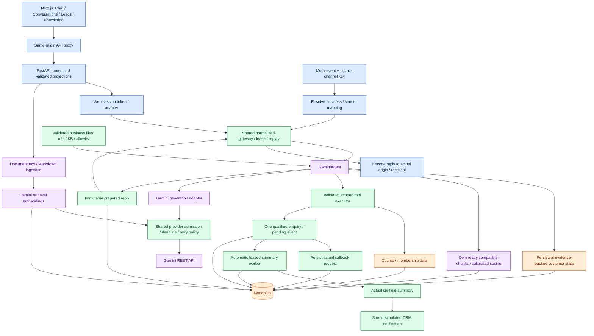

# Architecture

## Responsibilities and workflow

1. Next.js presents Chat, Conversations, Leads and Knowledge base using a same-origin REST proxy.
2. Web/mock adapters normalize their own payloads. The gateway derives trusted business/session/sender ownership, serializes turns and routes replies back to their actual origin.
3. The shared agent combines file-authoritative business instructions, persistent customer details/history, retrieval and allowed tools. Changes require original customer evidence; course order/discussion focus supports references and corrections.
4. RAG chunks and embeds scoped text/Markdown, retrieves the latest ready compatible document versions and returns sources. Validated exact quotes support policy answers; a bounded focused policy extraction can recover omitted passages.
5. The tool executor enforces the business allowlist and argument/result contracts. Courses/memberships supply current facts. Lead/callback receipts come from actual persisted operations, not model prose.
6. Lead creation stores an event/snapshot. A leased background worker generates a structured counselor summary from actual data and stores a simulated notification. Failures retain the lead and stages avoid duplicate effects.
7. Persistent message identity and immutable prepared replies support safe replay. Unsafe uncertain write windows remain review-required. Inspection APIs expose bounded DTOs; the UI ignores aborted/stale foreign-owner responses.

Mongo holds scoped business records, sessions, turns, lead/events, documents/chunks and execution records. Configuration remains file-authoritative. There is no real external messaging/CRM delivery or payment/enrollment integration. See [extensions](EXTENDING.md), [decisions](DECISIONS.md) and [limitations](LIMITATIONS.md).
