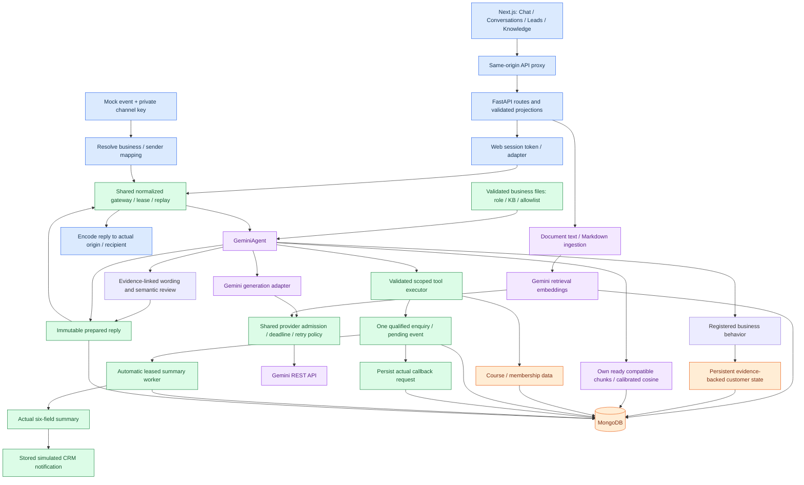

# Architecture

## Responsibilities and workflow

1. Next.js presents Chat, Conversations, Leads and Knowledge base using a same-origin REST proxy.
2. Web/mock adapters normalize their own payloads. The gateway derives trusted business/session/sender ownership, serializes turns and routes replies back to their actual origin.
3. The shared agent combines file-authoritative business instructions, persistent customer details/history, retrieval and allowed tools. Changes require original customer evidence; course order/discussion focus supports references and corrections.
4. RAG chunks and embeds scoped text/Markdown, retrieves the latest ready compatible document versions and returns sources. Validated exact quotes support policy answers; a bounded focused policy extraction can recover omitted passages.
5. The tool executor enforces the business allowlist and argument/result contracts. Courses/memberships supply current facts. Lead/callback receipts come from actual persisted operations, not model prose.
6. Lead creation stores an event/snapshot. A leased background worker generates a structured counselor summary from actual data and stores a simulated notification. Failures retain the lead and stages avoid duplicate effects.
7. Persistent message identity and immutable prepared replies support safe replay. Unsafe uncertain write windows remain review-required. Inspection APIs expose bounded DTOs; the UI ignores aborted/stale foreign-owner responses.

8. Registered business behaviors isolate course dialogue from the shared engine. Optional evidence-linked wording is reviewed before display, with verified factual/receipt fallbacks. Classified transient failures allow only bounded safe recovery; unresolved write uncertainty is not blindly retried.

Budget proposals and source evidence use the same numeric normalization. Search lists preserve server-owned ordering through final rendering, so ordinal selections refer to the displayed courses. Acknowledgements of preference changes require a saved change from the current customer turn.

Mongo holds scoped business records, sessions, turns, lead/events, documents/chunks and execution records. Configuration remains file-authoritative. There is no real external messaging/CRM delivery or payment/enrollment integration. See [extensions](EXTENDING.md), [decisions](DECISIONS.md) and [limitations](LIMITATIONS.md).

## Conversation completion and latency boundaries

Training and fitness dialogue live in registered business behaviors, rather than
channel-specific engine branches. Membership ordinal references are resolved from
that session's displayed tool receipts, followed by a fresh membership read.
They do not populate course-selection state or enable institute-only writes.

For a plain, complete catalogue-search request, a bounded parser can propose only
facts literally present in the message. Normal provenance/state validation still
runs, and Gemini still chooses the tool. Corrections, mixed requests and pending
write workflows use the full extraction path. No current price is cached here.
Registered validated read results may finish a turn without another model call;
this completion metadata cannot bypass tool permissions or confirm a write.

Enrolment guidance offers an enquiry, collects missing contact details and uses
actual lead receipts. Saved-enquiry guidance and callback status are separate:
a status question does not create consent for a new callback. Daily quota errors
are reported clearly without futile immediate retries. Timings and counters omit
customer payloads and provider credentials.

## Contextual reads and policy boundaries

Course search accepts an optional budget (also accepting `maxBudget` on input).
With no supplied budget it browses the actual category without a price filter;
when preferences exist, the application still rejects invented or relaxed filters.
Accepted current-turn budget provenance makes subsequent validated search results
answerable even when the message contains only the corrected amount.

A course-detail reply can use the already resolved discussion/selection focus and
the semantic field classifier, instead of requiring a particular confirmation
phrase. An unrelated lookup does not authorize an unrelated answer. Eligibility
and beginner questions are explicitly routed toward knowledge in tool guidance.

Document presentation distinguishes an explicit unknown-price disclaimer from a
price assertion. A paragraph stating that fees are not established can retain its
independent access rules; price assertions (including zero-price claims) remain
excluded. Source span verification and coupled policy conditions still apply.
